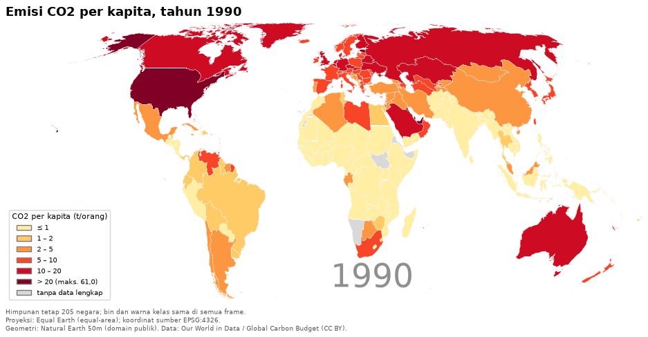
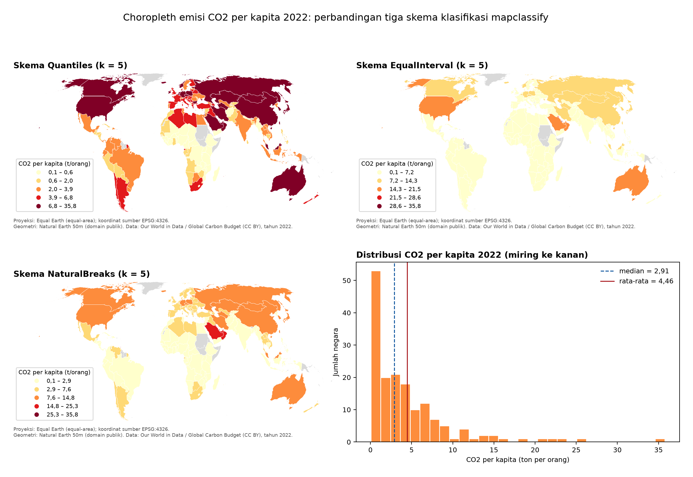
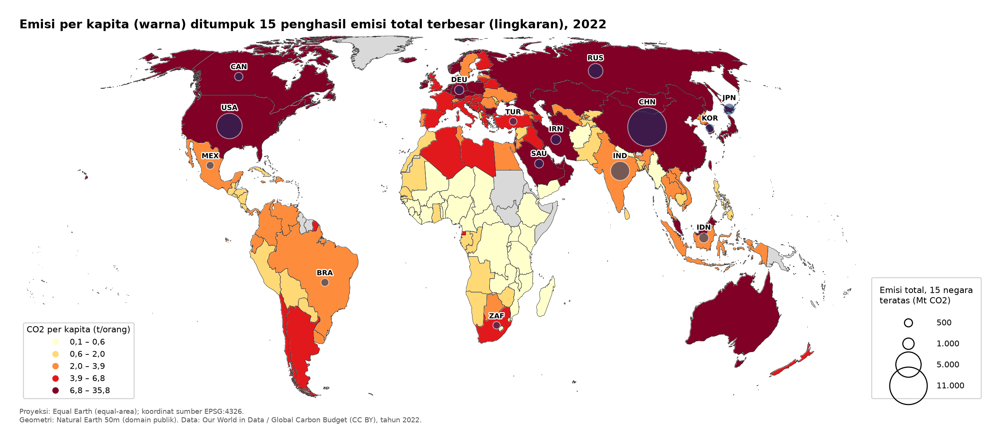
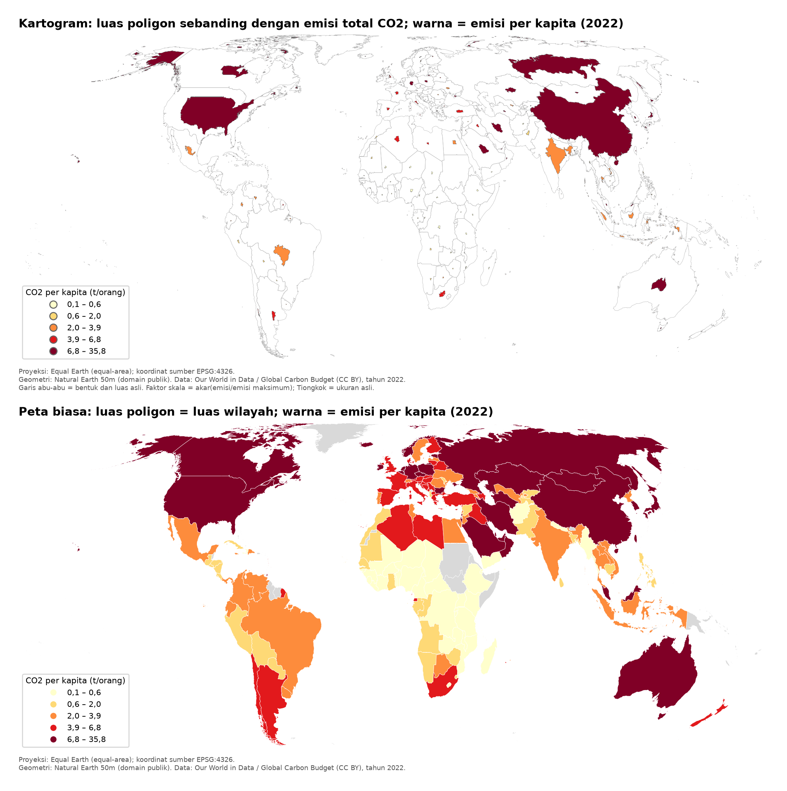
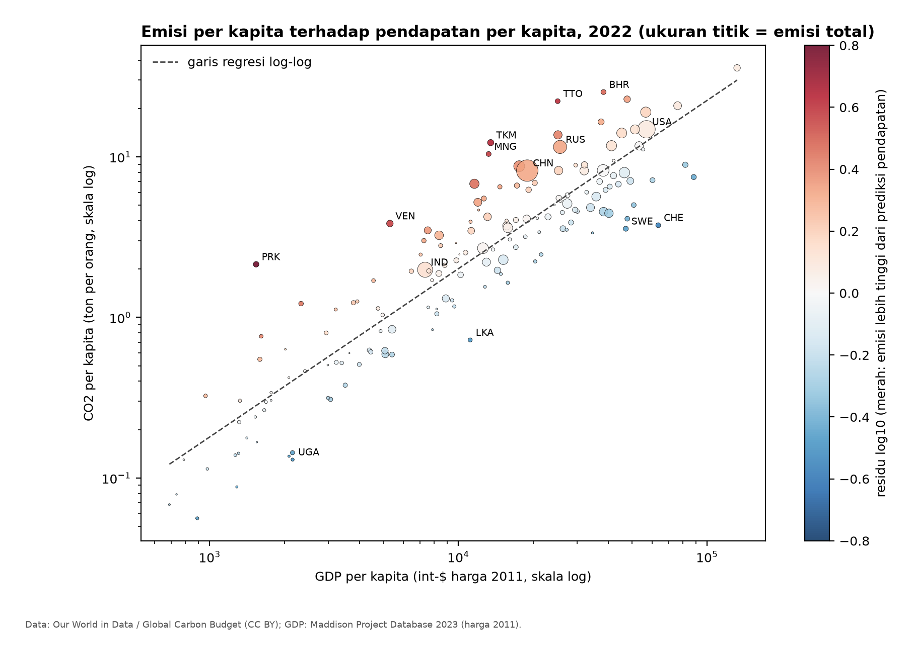

# Visualisasi Geospasial: Emisi CO2 vs Kemakmuran Antarnegara (2022)

Seberapa timpang emisi karbon dioksida (CO2) antarnegara, dan apakah negara yang lebih makmur otomatis mengeluarkan lebih banyak CO2 per penduduk? Proyek ini menjawabnya dengan peta, dari data nyata, dan semuanya bisa dijalankan ulang.




*Emisi CO2 per kapita (ton per orang) pada 205 negara, 1990 sampai 2022, dengan kelas warna yang sama di setiap bingkai. Median naik dari 2,63 ke 3,24 ton, sedangkan rata-rata turun dari 5,07 ke 4,72 ton. Emisi China naik 3,80 kali lipat, sedangkan emisi Amerika Serikat turun 26,7 persen.*

## Temuan singkat

Seluruh angka dihitung dari berkas yang diunduh, bukan diketik manual.

- **Emisi sangat terkonsentrasi.** Sepuluh emitor terbesar menyumbang 68,61 persen emisi dunia (China 31,21 persen, AS 13,52 persen, India 7,53 persen). Hanya 21 negara yang dibutuhkan untuk mencapai 80 persen.
- **Kemakmuran dan emisi per kapita berkaitan kuat.** Korelasi Spearman 0,896, dan regresi log-log menjelaskan 83,0 persen variasi (R² = 0,830).
- **Distribusinya miring.** Median emisi per kapita 2,91 ton, sedangkan rata-ratanya 4,46 ton. Skema klasifikasi peta ikut mengubah cerita yang tampak, sehingga tiga skema dibandingkan.
- **Proyeksi memengaruhi persepsi.** Pada proyeksi Mercator, Greenland tampak 3,93 kali Brasil, padahal luas sebenarnya hanya 0,26 kali.

## Galeri

| Tiga skema klasifikasi choropleth | Overlay dengan 15 emitor terbesar |
|---|---|
|  |  |

| Kartogram emisi | CO2 per kapita vs GDP per kapita |
|---|---|
|  |  |

Semua gambar ada di [outputs/figures/](outputs/figures/), dan satu PDF berisi seluruhnya ada di [outputs/](outputs/).

## Isi notebook

| Tahap | Isi |
|---|---|
| 1 | Deskripsi dataset, penyaringan, dan validasi terhadap nilai acuan |
| 2 | Persiapan geospasial: CRS, validitas geometri, variabel turunan |
| 3 | Peta dasar: Equal Earth dibandingkan dengan Mercator |
| 4 | Choropleth: tiga skema klasifikasi, GDP per kapita, skor relatif dengan colormap diverging |
| 5 | Pointplot (warna dan ukuran) dan overlay beberapa lapisan |
| 6 | Kartogram dan animasi spatio-temporal 1990 sampai 2022 |
| 7 | Insight berangka, kesimpulan, rekomendasi, dan keterbatasan |
| 8 dan 9 | Deklarasi penggunaan AI dan daftar pustaka APA 7 |

## Struktur repository

```
notebooks/       notebook lengkap (dengan penjelasan) dan notebook ringkas (kode saja)
scripts/         download_data.py, pengunduh data mandiri
data/raw/        berkas unduhan apa adanya (ikut disimpan; diunduh ulang otomatis bila hilang)
data/processed/  hasil penyaringan dan penggabungan (GeoJSON dan CSV)
outputs/         PDF kumpulan gambar dan folder figures/ (PNG 200 dpi dan GIF)
docs/            dokumen deklarasi penggunaan AI
requirements.txt versi pustaka yang dipin
```

Notebook utama: [Muhammad_Aulia_Muzzaki_Nugraha_2311102051_TugasGeospasial.ipynb](notebooks/Muhammad_Aulia_Muzzaki_Nugraha_2311102051_TugasGeospasial.ipynb). Folder `notebooks/` juga memuat versi ringkasnya.

## Cara menjalankan

Butuh Python 3.12 atau lebih baru.

```bash
git clone https://github.com/aulky/geospatial-data-visualization.git
cd geospatial-data-visualization

uv venv --python 3.12 .venv            # atau: python -m venv .venv
uv pip install -r requirements.txt     # atau: pip install -r requirements.txt
uv pip install pip                     # sel pemasangan di notebook memakai %pip
```

Buka notebook lalu jalankan semua sel (Run All). Data diunduh otomatis ke `data/raw/` bila belum ada. Pengunduhan juga bisa dijalankan sendiri:

```bash
python scripts/download_data.py
```

Eksekusi tanpa antarmuka:

```bash
cd notebooks
jupyter nbconvert --to notebook --execute --inplace "Muhammad_Aulia_Muzzaki_Nugraha_2311102051_TugasGeospasial.ipynb"
```

## Dataset

Tanggal akses kedua komponen: 24 November 2026.

1. **Geometri.** Natural Earth 50m Admin 0 Countries (GeoJSON, EPSG:4326), [berkas](https://raw.githubusercontent.com/nvkelso/natural-earth-vector/master/geojson/ne_50m_admin_0_countries.geojson), situs induk [naturalearthdata.com](https://www.naturalearthdata.com). Data berada di domain publik, dan kredit yang disarankan penyedia: "Made with Natural Earth." Kunci penggabungan adalah `ADM0_A3`, bukan `ISO_A3_EH` yang memuat kode ganda dan -99.
2. **Atribut.** Our World in Data (OWID), CO2 and Greenhouse Gas Emissions, [CSV](https://catalog.ourworldindata.org/emissions/owid_co2/owid_co2.csv) dan [kodebook](https://catalog.ourworldindata.org/emissions/owid_co2/owid_co2.codebook.csv). Repositori [owid/co2-data](https://github.com/owid/co2-data) tidak lagi diperbarui dan hanya dipakai sebagai cadangan. Data OWID berlisensi CC BY, sedangkan data pihak ketiga mengikuti lisensi aslinya. Kutipan: "Global Carbon Budget (2026) and other sources – with major processing by Our World in Data." Sumber asli menurut kodebook: Global Carbon Budget (Global Carbon Project) untuk emisi, Maddison Project Database 2023 (Bolt dan van Zanden) untuk GDP, dan sumber beragam yang dihimpun OWID untuk populasi.

**Penyaringan.** Tahun 2022, `iso_code` terisi dan bukan agregat OWID, serta lengkap pada `population`, `gdp`, `co2`, `co2_per_capita`, `share_global_co2`, dan `cumulative_co2`. Hasilnya 164 negara lengkap, dan 163 di antaranya tergabung dengan geometri (Palestine tidak cocok). Gabungan ini mencakup 97,06 persen emisi dunia.

## Catatan

- Emisi `co2` adalah emisi teritorial, tidak mencakup perubahan penggunaan lahan serta penerbangan dan pelayaran internasional. GDP memakai dolar internasional harga 2011.
- Satuan variabel dibaca dari kodebook OWID. Validasi terhadap nilai acuan (AS, China, India, Indonesia) menunjukkan selisih terbesar 0,14 persen.
- Kombinasi pustaka yang diuji: geopandas 1.2.0, geoplot 0.5.1, cartopy 0.26.0, mapclassify 2.11.0, shapely 2.2.0.
- Klasifikasi NaturalBreaks memakai inisialisasi acak, sehingga seed NumPy ditetapkan di notebook.
- Sebagian besar kode dan teks proyek ini disusun dengan bantuan alat AI. Rinciannya ada di [dokumen deklarasi](docs/).
